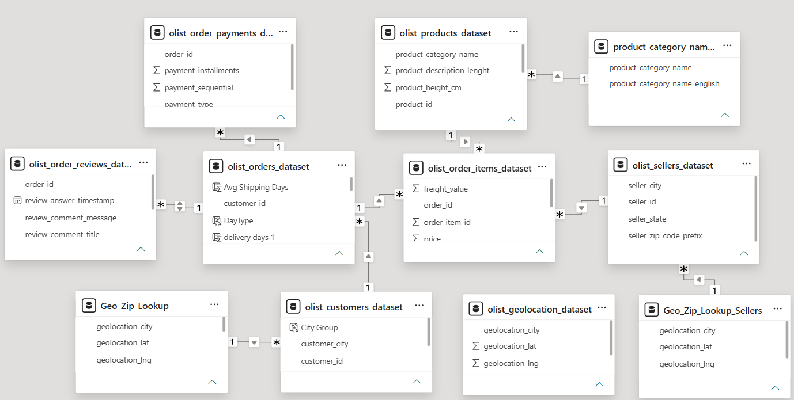

# Power BI module

The report has six pages: **KPI 1, KPI 2, KPI 3, KPI 4, KPI 5** and a **DASHBOARD** page.

## File

`Olist_Store_Analysis_Project__POWER_BI_.pbix` (about 59 MB; it contains the imported data).

> [TODO: GitHub warns for files over 50 MB and blocks files over 100 MB. Options: (a) add the `.pbix` with Git LFS,
> (b) attach it to a GitHub Release, or (c) export a data-free template (File > Export > Power BI template, `.pbit`) and commit that.
> Check the Kaggle licence before publishing a file that embeds the raw data.]

## What I did in this module

- Built the **data model**: fresh import of the 9 CSV files with Power Query (independent of the SQL database),
  9 relationships, two zip-lookup tables for geography, blank product categories set to `unknown` (610 products).
- Wrote the **KPI 2 measures** in DAX (see [`dax_measures.md`](dax_measures.md)).

## Data model

Tables: the 9 source tables plus `Geo_Zip_Lookup` (customers) and `Geo_Zip_Lookup_Sellers` (sellers), each with one row per zip prefix.
The raw geolocation table is loaded but not related to anything.

| Many side | Column | One side | Column | Filter direction |
| --- | --- | --- | --- | --- |
| order_items | order_id | orders | order_id | Single |
| order_payments | order_id | orders | order_id | Single |
| order_reviews | order_id | orders | order_id | Both |
| order_items | product_id | products | product_id | Single |
| order_items | seller_id | sellers | seller_id | Single |
| products | product_category_name | product_category_name_translation | product_category_name | Single |
| customers | customer_zip_code_prefix | Geo_Zip_Lookup | geolocation_zip_code_prefix | Single |
| sellers | seller_zip_code_prefix | Geo_Zip_Lookup_Sellers | geolocation_zip_code_prefix | Single |
| orders | customer_id | customers | customer_id | Single |

## Why the measures look the way they do

- **Distinct counts for orders.** An order can have several payment rows and several items, so a plain row count would overstate orders.
- **Per-order averages for KPI 4.** `Average Price` and `Average Payment` first average within each order, then across orders.
  Excel and Tableau average over item / payment rows instead, which is why KPI 4 differs by tool (see the main README).
- **`CROSSFILTER(..., BOTH)` for KPI 2.** Lets reviews and payments filter each other through the orders table, so each order is counted once.

## Opening the file

1. Open the `.pbix` in Power BI Desktop.
2. Home > Transform data > Data source settings > Change Source, and point each CSV to your local copy of the Kaggle files.
3. Refresh.
