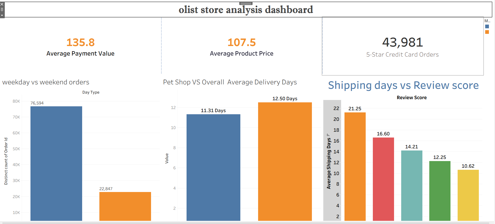

# Tableau module

Packaged workbook: `Olist_Store_Analysis_Project__TABLEAU_.twbx` (about 23 MB, includes a data extract).
Tableau Public link: **[TODO: publish the workbook to Tableau Public and paste the link here]**

## What I did in this module

I built the **data model from all 9 CSV tables** using Tableau Relationships (no joins, no custom SQL):

| Table | Related to | On |
| --- | --- | --- |
| customers | orders | customer_id |
| orders | order_items | order_id |
| orders | order_payments | order_id |
| orders | order_reviews | order_id |
| order_items | products | product_id |
| products | product_category_name_translation | product_category_name |
| customers | geolocation | customer_zip_code_prefix = geolocation_zip_code_prefix |
| geolocation | sellers | geolocation_zip_code_prefix = seller_zip_code_prefix |

The raw review file did not parse correctly in Tableau's text connector (unescaped quotes and commas inside multi-line review text
produced 14 fields instead of 7), so the data source is the 9 tables as cleaned and exported from the Excel stage.

## Workbook contents

Six worksheets and one dashboard: `KPI 1`, `KPI 2`, `KPI 3 Pet Shop Avg Delivery Days`,
`KPI 4 _Avg_Price of sao paulo`, `KPI 4 Avg_Payment of Sao Paulo`, `KPI 5`, and `Dashboard`.
The worksheets and the dashboard were built by other course participants.

## Calculated fields

```text
Purchase Day Type   IF DATEPART('weekday', [order_purchase_timestamp]) IN (1,7) THEN "Weekend" ELSE "Weekday" END

Score 5 Credit Card Orders
                    IF [review_score] = 5 AND [payment_type] = "credit_card" THEN [order_id] END
                    -- used with Count Distinct

shipping_days       DATEDIFF('day', [order_purchase_timestamp], [order_delivered_customer_date])

Pet Shop Avg Delivery Days
                    AVG(
                      IF [order_status] = 'delivered'
                         AND NOT ISNULL([order_delivered_customer_date])
                         AND {FIXED [order_id]: MAX(IF [product_category_name] = 'pet_shop' THEN 1 ELSE 0 END)} = 1
                      THEN DATEDIFF('day', [order_purchase_timestamp], [order_delivered_customer_date])
                      END
                    )

Order Total Payment {FIXED [order_id] : SUM([payment_value])}

Product Category Clean
                    IFNULL([product_category_name], "unknown")
```

## Dashboard



## Results shown

Weekday 76,594 / weekend 22,847 orders (Tableau keeps one order that has no payment record, which the inner joins in Excel, SQL and Power BI drop);
43,981 five-star credit card orders; pet_shop 11.31 days vs 12.50 overall; average price 107.5 and average payment 135.8 for Sao Paulo (row-level averages);
average shipping days from 21.25 (score 1) to 10.62 (score 5).
